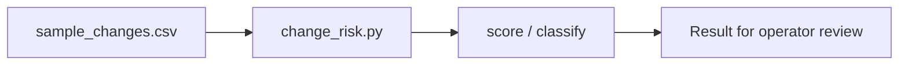

# Network Change Risk Matrix architecture

Scores network changes by device count, region count, rollback maturity, and customer tier.

## Operational boundaries

The documented run evaluates the bundled sample locally. Results depend on the quality and scope of the input. The demo makes no live infrastructure changes.
